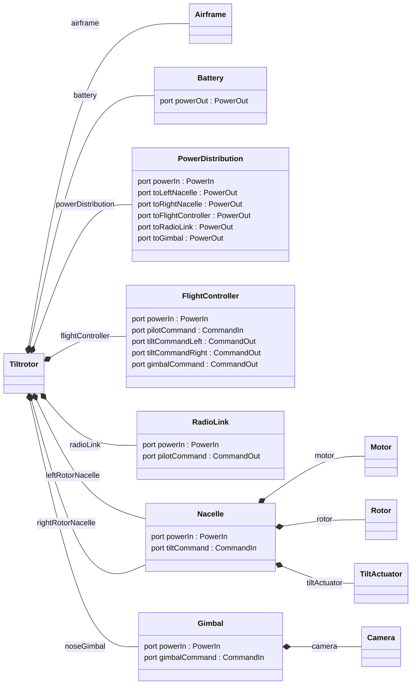
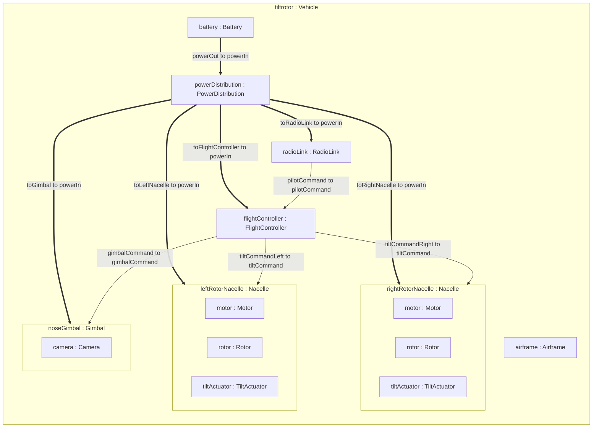
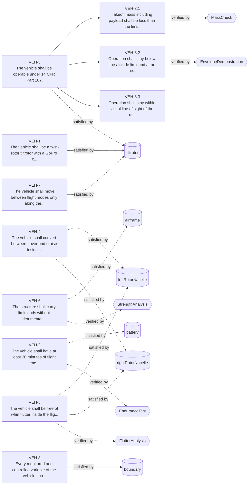
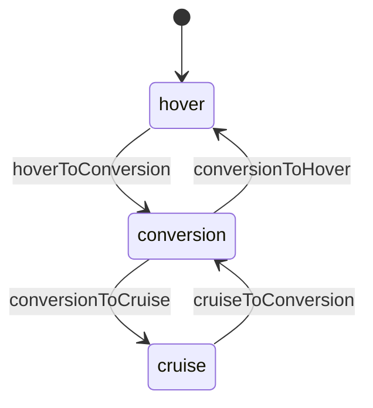
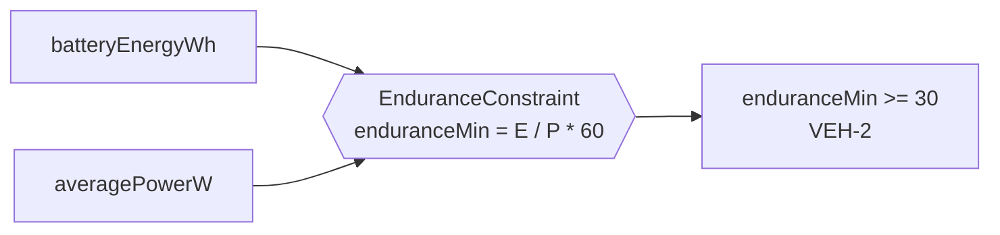
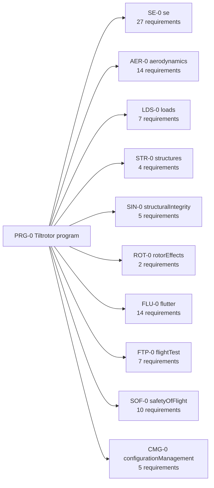

# SysML views

Generated by tools/views.py from the models. GitHub renders the diagrams below. The architecture in the block and interconnection views is a proposed one to confirm.

## Block definition diagram

Part definitions and what contains what. Each arrow reads: the whole contains the part, labelled with the part name.

## Internal block diagram

Parts of the tiltrotor and the connections between their ports. Thick arrows carry power, thin arrows carry commands. Proposed architecture, to confirm.

## Requirements and traceability

Vehicle requirements with decomposition (solid), allocation to parts (satisfy) and verification cases (verify). The program requirements that prove each one are in the traceability matrix below.

## Flight modes

Allowed transitions between hover, conversion and cruise (VEH-7).

## Endurance constraint

Parametric view of VEH-2: endurance in minutes equals battery energy divided by average power, times 60.

## Program structure

The top program and its ten discipline programs, with the number of requirements each owns.

## Traceability matrix

| Vehicle requirement | Parent | Allocated to | Verified by | Proven by program requirements |
|---|---|---|---|---|
| VEH-1 |  | tiltrotor | none yet | SE-2 |
| VEH-2 |  | battery | EnduranceTest | FTP-0 |
| VEH-3 |  | tiltrotor | none yet | SOF-0 |
| VEH-3.1 | VEH-3 |  | MassCheck |  |
| VEH-3.2 | VEH-3 |  | EnvelopeDemonstration |  |
| VEH-3.3 | VEH-3 |  | none yet |  |
| VEH-4 |  | leftRotorNacelle, rightRotorNacelle | none yet | AER-0 |
| VEH-5 |  | leftRotorNacelle, rightRotorNacelle | FlutterAnalysis | FLU-11, FLU-4 |
| VEH-6 |  | airframe | StrengthAnalysis | STR-1 |
| VEH-7 |  | tiltrotor | none yet | SE-19 |
| VEH-8 |  | boundary | none yet | SE-16 |
